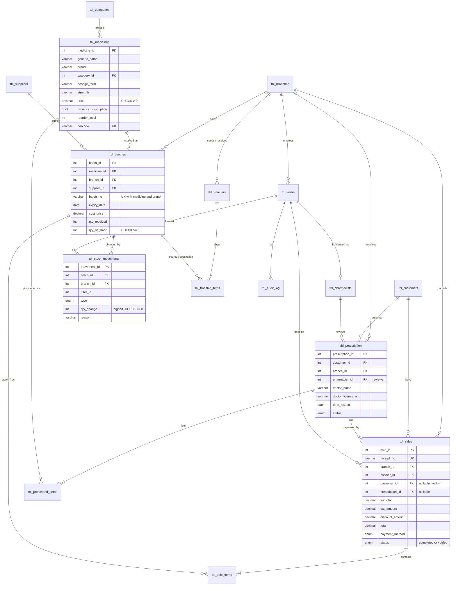

# Database design

The schema is `database/schema.sql`. It uses InnoDB, utf8mb4, `INT UNSIGNED` surrogate keys, and explicit foreign keys. History tables use `ON DELETE RESTRICT`, so sales, batches, and prescriptions are never orphaned. Master data is deactivated with `is_active` rather than deleted.

## Tables

The six tables from the approved proposal are kept with the same names. The others support the features the proposal describes.

| Table | Purpose | Key constraints |
|---|---|---|
| `tbl_branches` | Pharmacy branches | `name` unique |
| `tbl_users` | Sign-in accounts and roles | `username` unique; CHECK: non-admins must have a branch |
| `tbl_pharmacists` | Licensed pharmacists (proposal table) | `license_no`, `email`, `user_id` unique |
| `tbl_customers` | Patients and customers (proposal table) | `email` unique; CHECK: discount type needs an ID number |
| `tbl_categories` | Medicine categories | `name` unique |
| `tbl_suppliers` | Distributors | `name` unique |
| `tbl_medicines` | Catalog (proposal table) | unique (generic, brand, strength, form); `barcode` unique; CHECK price > 0 |
| `tbl_batches` | Stock per medicine, per branch, per expiry date | unique (medicine, branch, batch_no); CHECK qty_on_hand ≥ 0; index for FEFO lookups |
| `tbl_prescription` | Prescriptions (proposal table) | FK customer, branch, reviewer, creator |
| `tbl_prescribed_items` | Medicines on a prescription (proposal table) | unique (prescription, medicine); CHECK dispensed ≤ prescribed |
| `tbl_sales` | Sale header (proposal table) | `receipt_no` unique; CHECK tendered ≥ total |
| `tbl_sale_items` | Sale lines, one per batch drawn | FK sale, medicine, batch |
| `tbl_stock_movements` | Ledger of every stock change | CHECK qty_change ≠ 0 |
| `tbl_transfers`, `tbl_transfer_items` | Inter-branch transfers | CHECK from ≠ to |
| `tbl_audit_log` | Sensitive actions | index on date |

## Design decisions

- **Stock lives on batches, not on the medicine row.** The proposal lists "stock quantity" on medicines. Storing it on batches instead means every unit has a known expiry date and branch, so expiry alerts and FEFO are possible. The medicine's stock is a `SUM` over its sellable batches.
- **The ledger reconciles exactly.** For every batch, `qty_on_hand` equals the sum of `tbl_stock_movements.qty_change`. The automated tests check this after each stock operation.
- **One sale line per batch.** If a cart line needs units from two batches, it is stored as two `tbl_sale_items` rows. The receipt groups them and lists both batch numbers, which allows recall tracing.
- **Walk-in sales.** `customer_id` and `prescription_id` on sales are nullable, which the original API did not allow.
- **Money is `DECIMAL`.** Totals are computed in integer centavos in Node, so there is no floating-point drift.
