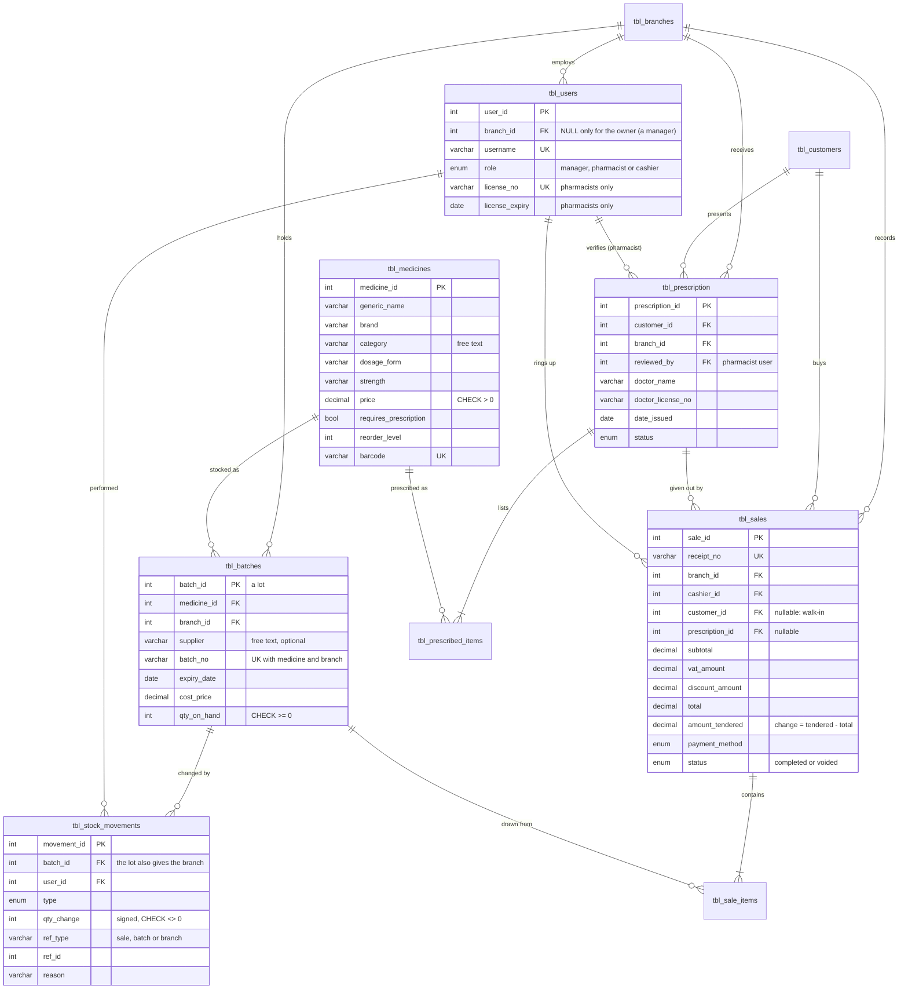

# Database design

The schema is `database/schema.sql`: **10 tables**, InnoDB, utf8mb4, `INT UNSIGNED` surrogate keys, and explicit foreign keys. History tables use `ON DELETE RESTRICT`, so sales, lots and prescriptions are never orphaned. Master data is deactivated with `is_active` rather than deleted.

## Tables

| Table | Purpose | Key constraints |
|---|---|---|
| `tbl_branches` | Pharmacy branches | `name` unique |
| `tbl_users` | Sign-in accounts, roles, and pharmacist licenses | `username` and `license_no` unique; CHECK: only managers may have no branch; CHECK: pharmacists must have a license and expiry |
| `tbl_customers` | Patients and customers (proposal table) | CHECK: discount type needs an ID number |
| `tbl_medicines` | Catalogue (proposal table) | unique (generic, brand, strength, form); `barcode` unique; CHECK price > 0 |
| `tbl_batches` | Lots: stock per medicine, per branch, per expiry date | unique (medicine, branch, lot no.); CHECK qty_on_hand ≥ 0; index for earliest-expiry lookups |
| `tbl_prescription` | Prescriptions (proposal table) | FK customer, branch, reviewer, creator |
| `tbl_prescribed_items` | Medicines on a prescription (proposal table) | unique (prescription, medicine); CHECK given out ≤ prescribed |
| `tbl_sales` | Sale header (proposal table) | `receipt_no` unique; CHECK tendered ≥ total |
| `tbl_sale_items` | Sale lines, one per lot drawn | FK sale, medicine, lot |
| `tbl_stock_movements` | Stock history: every change to every lot | CHECK qty_change ≠ 0 |

The `sessions` table is created by the sign-in library (`express-mysql-session`) and is not part of the design.

## Design decisions

- **Stock lives on lots, not on the medicine row.** The proposal lists "stock quantity" on medicines. Storing it on lots instead means every unit has a known expiry date and branch, so expiry warnings and earliest-expiry-first selling are possible. A medicine's stock is a `SUM` over its sellable lots.
- **Stock history reconciles exactly.** For every lot, `qty_on_hand` equals the sum of `tbl_stock_movements.qty_change`. The automated tests check this after each stock operation.
- **One sale line per lot.** If a cart line needs units from two lots, it is stored as two `tbl_sale_items` rows. The receipt groups them and lists both lot numbers, which allows recall tracing.
- **Walk-in sales.** `customer_id` and `prescription_id` on sales are nullable.
- **Money is `DECIMAL`.** Totals are computed in integer centavos in Node, so there is no floating-point drift.

## Simplification

The first version had 17 tables. It was complete, but too much for a school pharmacy system and its users. It was narrowed in two steps without losing any function.

| Removed | Now | Why it still works |
|---|---|---|
| `tbl_pharmacists` | `license_no`, `license_expiry` on `tbl_users` | A pharmacist is a staff account. The license is in one place, and the reviewer of a prescription (`reviewed_by`) is the user who signed in. |
| `tbl_categories` | `category` text on `tbl_medicines` | Typing a category suggests the ones already in use (`GET /categories`), so spelling stays consistent. |
| `tbl_suppliers` | `supplier` text on `tbl_batches` (optional) | Same: suggestions come from past deliveries (`GET /suppliers`). |
| `tbl_transfers`, `tbl_transfer_items` | Two lines in `tbl_stock_movements` | Sending stock writes `transfer_out` on the sending lot and `transfer_in` on the receiving lot, each with `ref_type = 'branch'` and the other branch's ID. Lot numbers and expiry dates carry over. |
| `tbl_audit_log` | Records already on the data | Voids keep who, when and why on the sale (`voided_by`, `voided_at`, `void_reason`). Every stock change keeps who and why in stock history. Prescriptions keep who recorded and who verified them. |
| Unused columns | Dropped | `updated_at` on every table, the second timestamp on lots, `qty_received`, `change_due` (calculated as tendered minus total), and the branch on stock history (it comes from the lot). |
| Admin role, 4-state transfers, customer email, address and birthdate | Removed | See `docs/DESIGN.md`. |

Five of the six tables named in the approved proposal are kept under the same names (`tbl_customers`, `tbl_medicines`, `tbl_prescription`, `tbl_prescribed_items`, `tbl_sales`). The sixth, `tbl_pharmacists`, was merged into `tbl_users` as described above.
